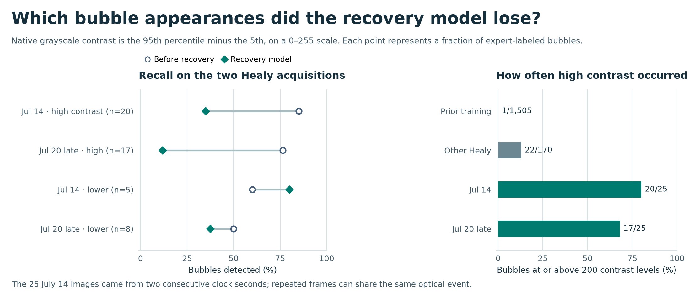

# Healy bubble errors, Arctic amphipods and a fresh VPR cruise

A retrained SIG.AI Video Plankton Recorder (VPR) classifier recognized **49 of 50 bubbles** across the two *Healy* acquisitions where its predecessor had recognized 16. It specifically identified **one of six** Arctic amphipod images held aside from the new fit. On a previously unused cruise, it called **28 of 222** expert-identified organisms bubbles, down from 31. The fresh cruise contained no confirmed optical-bubble positives, so fresh-cruise bubble recall remains unmeasured.

## What did the new model recover?

We locked the previous recovery model as the comparison and trained on the Ocean Observatories Initiative’s NVIDIA L40S using 5,487 VPR crops. The new model uses separate decisions for bubble screening and organism identification, with additional information about crop shape, contrast and the distribution of brightness. We froze the model and bubble cutoff after development on 1,482 images, then scored the same held-aside images with both models.

| Evaluation panel and outcome | Previous recovery model | Retrained candidate |
| --- | ---: | ---: |
| Healy July 14, bubbles detected | 11/25 | 25/25 |
| Healy July 20 late, bubbles detected | 5/25 | 24/25 |
| Healy, all organisms retained on these two acquisitions | 31/31 | 31/31 |
| Healy, amphipods specifically identified on these two acquisitions | 0/6 | 1/6 |
| Canada CAR2022299 historical panel, larvae retained | 241/250 | 239/250 |
| Canada CAR2022299, specifically identified as larvae | 124/250 | 125/250 |
| Fresh Hokuto 2017 cruise, expert-identified organisms retained | 191/222 | 194/222 |

The retrained model recovered 33 previously missed Healy bubbles and kept all 16 its predecessor recognized. High-contrast bubble detections rose from 9/37 to 36/37. All 13 elongated bubble images in the late July 20 acquisition were recovered. The 25 July 14 images occurred within two consecutive clock seconds. Giving each of seven temporal bursts equal weight yields 28.6% versus 85.7% recall across the two acquisitions. This sensitivity check groups consecutive frames within two seconds and measures variation across known events. July 14 and late July 20 were reserved from training and model selection, but their earlier errors motivated the experiment. A different acquisition from early July 20 entered the fit. [Healy expedition record](https://www.ncei.noaa.gov/waf/ocean-exploration-nofo/16arctic/16arctic_cruise_landing_page.html)

Of the original 14 amphipod images, five entered training, three entered development and six entered the historical diagnostic. The candidate specifically identified five of five, one of three and one of six, respectively. The one held-aside July 14 amphipod was correctly identified. All five late July 20 frames, recorded within one second, remained “other organism.” The Hamburg reference audit stayed at 95/95 correct amphipods. On two Japanese deployments from the previously studied MR17-07C cruise, bubble detections rose from 153/160 to 160/160, while two of 36 organisms were newly discarded. [Hamburg image release](https://doi.org/10.5281/zenodo.4431509) · [First Japanese deployment](https://ecotaxa.obs-vlfr.fr/api/projects/3108) · [Second deployment](https://ecotaxa.obs-vlfr.fr/api/projects/3109)

## What transferred to fresh cruises?

Hokuto 2017 contributed 222 expert-validated, named organisms from two acquisitions in Suruga Bay. The two models retained 180 versus 182 of 206 from the first acquisition and 11 versus 12 of 16 from the second. Across the cruise, six earlier false bubble calls were corrected and three new ones appeared. The number wrongly labeled specifically as amphipods rose from eight to ten. The source has no validated bubble, amphipod or explicit larval cases in this eligible sample. The named-organism results measure false bubble calls. Twenty ambiguous or unidentified source crops were reserved for expert review and excluded from this benchmark. [JAMSTEC Hokuto 2017 expert annotations](https://ecotaxa.obs-vlfr.fr/api/projects/3180)

Four additional, previously unused cruises supplied **one source-identified image each**. The Icelandic AF072020 amphipod was correctly identified by both models. Both models retained all three larvae as organisms. Only the predecessor correctly used the larva label for the native Sargasso Sea OC404-01 specimen. Neither model identified the RUSALCA ophiuroid larva or the DE 11-10 Atlantic herring larva as a larva. The Icelandic and NOAA samples are publication exemplars, while the Sargasso sample is an archive-native, author-named image. These individual observations cannot establish cruise-level rates. [Icelandic cruise report, figure 15C](https://www.hafogvatn.is/static/research/files/hv2021-22.pdf) · [RUSALCA, slide 6](https://www.pmel.noaa.gov/rusalca/sites/default/files/atoms/files/Video%20Plankton%20Recorder%20Ashjian.pdf) · [Sargasso Sea archive](https://www.bco-dmo.org/dataset/3033) · [NOAA DE 11-10 cruise account](https://nefsc.wordpress.com/2011/12/08/different-gear-different-samples/)

On the larger historical Canadian panel, the candidate recovered one larva and newly called three larvae bubbles. Retention fell 0.8 percentage points. One of 46 sampling groups improved, three declined and 42 tied. A descriptive interval from 20,000 paired resamples of whole acquisitions spans −2.4 to +0.8 points. Veligers accounted for a net loss of two retained images. The frozen model sends every specimen that its predecessor specifically called a larva through its bubble screen, but this protects only one portion of the true larvae. The modest observed loss failed the aim of preserving retention on every panel. [Canadian VPR annotations](https://ecotaxa.obs-vlfr.fr/api/projects/10429)

## What happened in the previous model?

The previous VPR model stopped recognizing many bright, partial bubble outlines. On July 14, Healy detections fell from 20 to 11 of 25. On late July 20, detections fell from 17 to five of 25. Review of every crop showed occasional complete rings alongside partial arcs, streaks and highlights extending through frame edges. Similar features can also occur in correctly identified bubbles.

Using a descriptive cutoff of 200 intensity levels between the 5th and 95th percentiles of an 8-bit grayscale crop, 37 of the 50 problem-acquisition bubbles had high contrast. The two previous models recognized 30 and nine of those 37. Both recognized seven of the other 13 bubbles. Only one of 1,505 bubble images used to fit the incumbent reached that contrast cutoff. On late July 20, the incumbent also missed all 13 crops with an aspect ratio of at least 2:1, including eight the earlier model recognized. These observations identify gaps in training coverage. Exposure and independent image-focus measurements were unavailable. [Healy VPR source](https://ecotaxa.obs-vlfr.fr/api/projects/3177) · [Earlier benchmark](vpr_bubble_recovery.md)

All 14 expert-labeled Arctic amphipods survived the incumbent’s bubble screen but received the broader “other organism” label. Twelve were identified as *Themisto abyssorum* and two as other Hyperiidea. Among the 373 training amphipods, seven were explicitly identified as Hyperiidea and none was explicitly labeled *Themisto*. The remaining source labels were broader. The Arctic crops had a median native area of 9,624 pixels, compared with 15,295 for the Hamburg training amphipods and 51,840 for those from Fisheries and Oceans Canada. These differences motivate recruiting more examples of small Arctic amphipods from multiple deployments. Changing only the bubble threshold cannot fix a biological label ranking.

## Where the new training data came from

The team added 58 expert-validated controls from JAMSTEC’s *Mirai* MR11-03, 91 controls from the Kochi 2024 VPR field project, and seven cruise-scientist-captioned images from *Oceanus* OC473, including one amphipod. The Kochi source identifies a field project but gives no vessel cruise identifier. OC473 contributed published images and lacks native frame and tow metadata. Additional training crops from previously studied cruises included 555 Healy bubbles, 289 Canadian amphipods and 120 Canadian larvae. Separate, historical images also contributed to fitting and development. [MR11-03 annotations](https://ecotaxa.obs-vlfr.fr/api/projects/2969) · [Kochi VPR annotations](https://ecotaxa.obs-vlfr.fr/api/projects/14390) · [OC473 scientist captions](https://funwithkrill.blogspot.com/2011/) · [WHOI cruise record](https://www.whoi.edu/cruiseplanning/synopsis.do?id=1202)

## Blinded visual review after the model was frozen

An AI reviewer working in chat labeled anonymized VPR images and recorded its decisions before seeing the source annotations. On 32 previously studied, expert-labeled images, eight from each of four groups, it matched the expert on **27/32 overall** and **27/28 of the images it classified**. It abstained on four and mistook one Fritillariidae larvacean for a bubble. The small panel deliberately included difficult Healy acquisitions. In a separate review of 120 survey images, the reviewer proposed nine bubbles, all from two *Oceanus* OC415-01 tows, and marked 104 images uncertain. Expert confirmation of those nine candidates is pending. Fresh-cruise bubble recall remains unknown. [Original EDDIES VPR archive](https://www.bco-dmo.org/dataset/3033)
