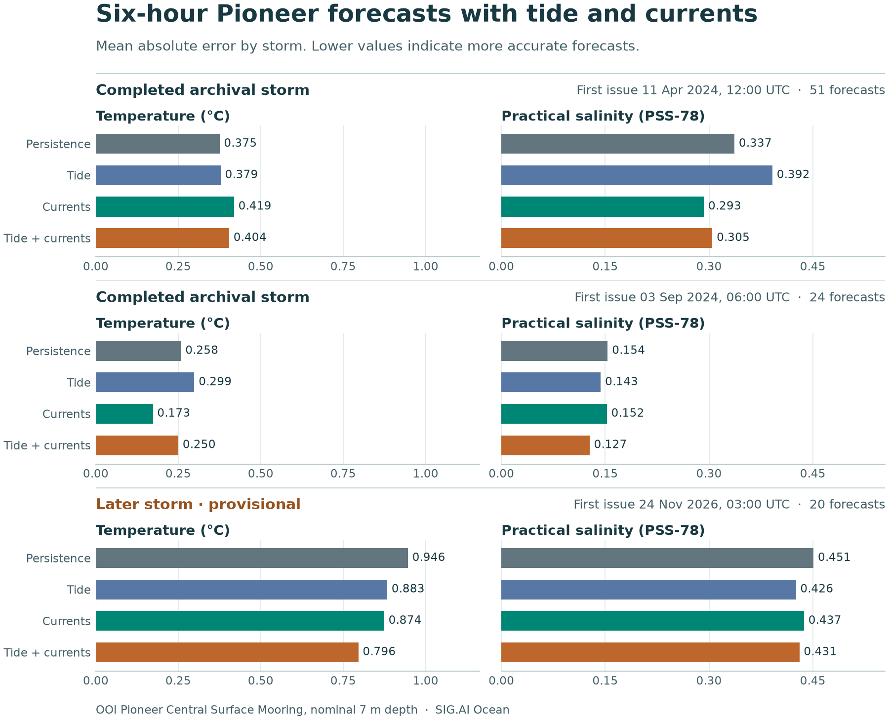

# Do tides and currents improve the six-hour Pioneer forecast?

**Salinity improved in both completed storm tests when we added tide and current together.** The equal-storm mean absolute error (MAE) fell from 0.245 to 0.216, a reduction of 12%. Currents alone also improved salinity in both storms. The temperature result depended on the event and how the errors were weighted. [Public results](https://ocean.sig.ai/world-model.html#pioneer-tide-current) · [OOI research folder](https://jupyter.oceanobservatories.org/user/yong206@gmail.com/lab/workspaces/ocean-world-model/tree/data/ocean-platform/world-model/pioneer-6h-tide-current)

| Six-hour forecast | Completed storms, temperature MAE (°C) | Completed storms, practical salinity MAE | Ongoing November storm, temperature MAE (°C) | Ongoing November storm, practical salinity MAE |
| --- | ---: | ---: | ---: | ---: |
| Persistence | 0.317 | 0.245 | 0.946 | 0.451 |
| Tide | 0.339 | 0.268 | 0.883 | 0.426 |
| Currents | 0.296 | 0.222 | 0.874 | 0.437 |
| Tide + currents | 0.327 | 0.216 | 0.796 | 0.431 |

The completed-storm columns weight April and September 2024 equally, with 51 and 24 verifying hours respectively. A tide-only correction increased average error on both targets. Currents alone reduced equal-storm temperature error by 0.021 °C, with a gain in September and a loss in April. Pooling the 75 hours gives 0.340 °C for currents and 0.338 °C for persistence. Tide plus currents improved salinity by 0.032 in April and 0.026 in September. The April fit had just 109 earlier training hours, compared with 2,691 for September.

The November storm is the only qualifying episode observed after the October cutoff. At the November 26, 02:00 UTC wave-data cutoff it was still open, with significant wave height reaching 5.45 m. The mooring had reported verifying temperatures and salinities for only 20 early forecast issues, November 24 at 03:00–22:00 UTC. The last verification was November 25 at 04:00 UTC. Tide plus currents gave the lowest early temperature error. Tide alone gave the lowest early salinity error. These scores cover part of one event and will change as additional observations arrive. The sample is too small for a general skill claim.



## What was held out

The post-October window is chronologically fresh. For additional completed events, we reconstructed the exact CTD timestamps consumed by the previous 7,556 training issues and 926 scoring issues, including lags and targets. Three historical storm windows had zero overlap with those timestamps. April 12 and September 3, 2024 had verifying measurements. The January 24, 2026 window had no eligible issue–target pairs. The windows were selected using the wave record and timestamp overlap, independent of the new errors. They are archived cases distinct from the November follow-up. [All prior overlap counts](data/archive_windows.csv) · [Forecast coverage](results/coverage.csv)

Each fold trained only on earlier data, applied a 72-hour purge, and protected all test windows across all fits. The same issue hours and readouts were used in each arm. The experiment predicts a correction to the latest nominal 7 m CTD observation from four Duck astronomical tide features, four colocated current features, or their combination. The tidal forecast is a coastal proxy 62 km away. Current measurements come from the Pioneer velocity meter on the same mooring and at the same nominal depth as the CTD. Only prior observed currents enter a forecast. Some tide inputs describe future heights that can be predicted astronomically. Native telemetry receipt times and historical versions of the harmonic tables could not be verified. [Protocol](PROTOCOL.md) · [Tides](sources/TIDES.md) · [Currents](sources/CURRENTS.md) · [Wave-event extension](sources/FRESH_SOURCES.md)

## Reproduce the OOI run

Run from this directory with Python and NumPy. The plot additionally uses Matplotlib.

```sh
OPENBLAS_NUM_THREADS=1 python run_study.py --data data --out results
python plot_scores.py --results results --output tide-current.png
```

The data directory includes frozen hourly observations, predictions of the astronomical tide, and event windows. To reconstruct the previous model's exposure ledger from its frozen study, run `python sources/audit_previous_split.py --previous ../pioneer-6h --output data/archive_windows.csv`. The CTD snapshot combines the earlier source through October 31 with the new OOI extraction from November 1 onward. Source versions and hashes are in `sources/` and [the run summary](results/summary.json).

[Errors and gains by cohort](results/scores.csv) · [Errors for each storm](results/per_event.csv) · [Every paired forecast and verifying observation](results/predictions.csv)
