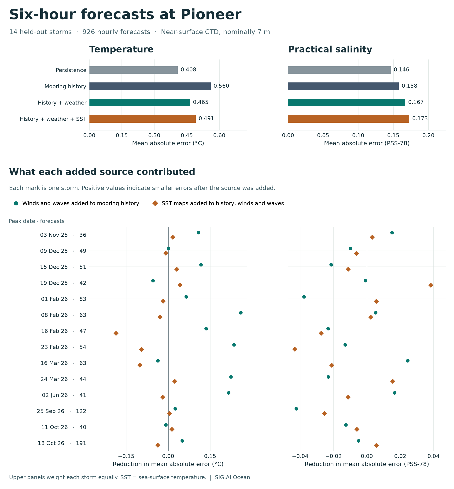

# Six-hour temperature and salinity forecasts at Pioneer

**Persistence produced the lowest mean absolute error for both targets.** Across 926 forecasts in 14 held-out storms, carrying the latest CTD observation forward gave 0.408 °C mean absolute temperature error and 0.146 practical salinity error. Each storm has equal weight. The run used NumPy on the OOI Jupyter CPU. A separate local run reproduced all predictions and metrics within 1e-10. [World model results](https://ocean.sig.ai/world-model.html#pioneer-forecast-results) · [OOI run figure, signed-in workspace](https://jupyter.oceanobservatories.org/user/yong206@gmail.com/lab/workspaces/ocean-world-model/tree/data/ocean-platform/world-model/pioneer-6h/pioneer-6h.png)

| Model | Temperature MAE (°C) | Practical salinity MAE |
| --- | ---: | ---: |
| Persistence | 0.408 | 0.146 |
| Mooring history | 0.560 | 0.158 |
| History + winds and waves | 0.465 | 0.167 |
| History + winds, waves and satellite SST | 0.491 | 0.173 |

**Winds and waves contributed temperature skill relative to mooring history alone.** Adding them reduced average storm temperature error by 0.095 °C (paired 95% storm-bootstrap interval 0.042 to 0.148 °C) and improved 11 of 14 storms. That model still averaged 0.057 °C more error than persistence. For salinity the weather inputs increased mean error by 0.009, with improvements on four storms.

**The available satellite maps added no average improvement.** After adding them to the wind-and-wave model, mean errors increased by 0.026 °C and 0.006 practical salinity. Both incremental 95% intervals include zero. Temperature and salinity each improved on six storms. MUR is a blended satellite and in-water analysis. Using conservative archive availability, the latest eligible map at issue time was 7.96 to 10.33 days old, with a median of 9.46 days. This tests the recent shelf temperature pattern. Fresh imagery during storm passage requires a different product and a separate test.

At Gianna, 83 paired forecasts were scored. Temperature MAEs were 0.488, 0.588, 0.524 and 0.542 °C in the model order above. Salinity MAEs were 0.088, 0.100, 0.138 and 0.132. Individual events can differ from the overall comparison.



## Coverage and evaluation

The CTD was nominally at 7 m on the OOI Central Surface Mooring. Issue-time observations, lags and targets were paired within individual deployments. Hourly wind vectors came from the OOI Southern mooring and significant wave height from the Oregon Inlet buoy. The satellite input used 25 cells across the North Carolina shelf. See the [protocol](PROTOCOL.md), [CTD provenance](sources/ctd_provenance.json), [weather and storm definitions](sources/WEATHER.md), and [satellite provenance](sources/SST_SOURCES.md).

Training used 7,556 complete hours, from August 3, 2024 through October 28, 2025. The held-out period began November 1, 2025 and ended October 31, 2026. Fifteen wave-defined events supplied 1,000 potential issue times. The January 24, 2026 event had no usable CTD issue–target pairs (68 hours). Six additional hours lacked complete mooring history. All four methods were scored on the remaining 926 hours. Storm thresholds, predictors, chronology, regularization and the primary metric were fixed before reviewing scores. The results describe this shelf site and model family. Instrument receipt times could not be verified historically. Retrospective QC and storm identification make this a hindcast. Scientifically, the next independent test would compare persistence with a tide-aware predictor and a lower-latency SST feed on new storms.

## Reproduce the OOI run

The frozen scientific inputs are in `data/`. NumPy fits the ridge models. Matplotlib is used only for the figure.

```sh
OPENBLAS_NUM_THREADS=1 python run_hindcast.py --data data --out results
python plot_scores.py --results results --output pioneer-6h.png
```

The [run summary](results/summary.json) records the OOI software versions, eligible times, map ages and SHA-256 hashes of the four fit inputs. The packed raw-cell subset and acquisition scripts can be used to audit or refresh their public-source inputs independently. A discovery service update can alter satellite revision timestamps, so use the frozen inputs to reproduce these numbers.

- [All 926 forecasts and observations](results/predictions.csv)
- [Storm-averaged and pooled metrics, including RMSE and bias](results/metrics.csv)
- [Paired improvements, wins and bootstrap intervals](results/comparisons.csv)
- [Errors by storm and target](results/per_storm.csv)
- [Coverage of every held-out storm](results/storm_coverage.csv)
